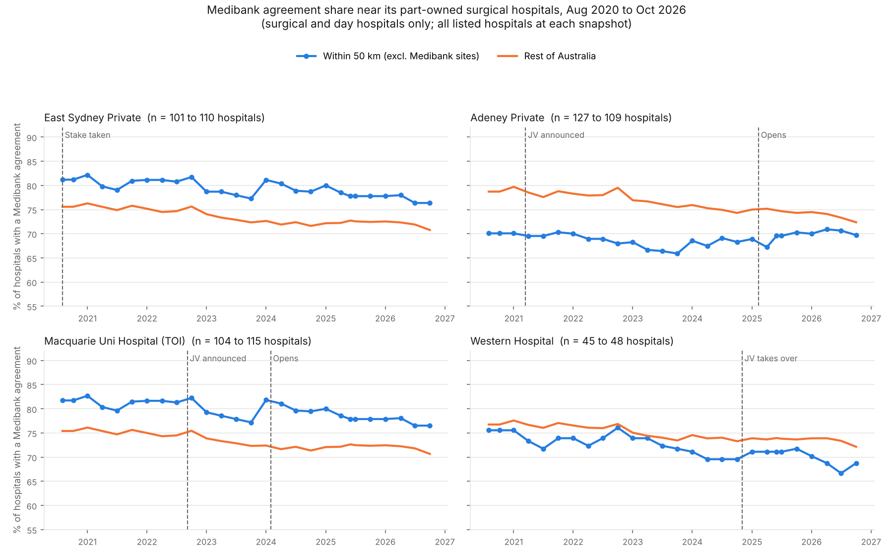

# Finding 1: Has Medibank changed its contracting near its part-owned hospitals?

Date: 27 Nov 2026
Data: `data/raw/medibank_agreements_2020-2026.xlsx` (supplied by David; Medibank agreement status by hospital, 27 snapshots, 1 Aug 2020 to 1 Oct 2026, 726 hospitals)
Code: `analysis/clean.py`, `analysis/radius.py`, `analysis/detail.py`, `analysis/charts.py`; independent re-check `analysis/recheck.py`
Outputs: `outputs/`

## Short answer

**No. In this data there is no detectable regional pattern of Medibank dropping or withholding agreements near its part-owned hospitals.** Around each surgical site, Medibank's agreement share moves with the national trend and its terminations are spread across Australia in proportion to where hospitals are. A small number of named losses near Adeney and in Sydney need checking, but the ones that look most significant are either explained (closures, public takeover) or look like data artefacts.

There is one finding that supports Brett: **Medibank shows no agreement with three of its own part-owned hospitals for long periods.** That is claim 3 in the brief, and it holds in this data. But it is also normal for new hospitals in this dataset, so on its own it is not evidence of anything.

## 1. Data checks first (because of 2025)

| Check | Result |
|---|---|
| Rows | 17,132; 100 zero-length rows removed (ToDate one day before FromDate) |
| Duplicates per hospital per snapshot | None |
| Status-flip burst at the late-2021 file change (the 2025 failure mode) | **None.** Largest single-quarter move is 7 losses. No sign of a fund swap |
| Healthscope hospitals during the Bupa and AHSA disputes (Feb to Mar 2025) | All stay contracted. Consistent with Medibank (Healthscope said Medibank was contracted), though not proof |
| Medibank's own sites | ESPH, MUH (TOI), Western, Hirondelle contracted throughout. Adeney, Deakin, Nundah not (see section 4) |
| Fund label in file | **None.** The file itself doesn't say it's Medibank. We rely on the source. **Must confirm before anything goes to Brett** |

**Artefact warning.** Six hospitals carry zero-length rows (Cabrini Malvern, Calvary Adelaide, Calvary Central Districts, Calvary Lenah Valley, Calvary St Luke's, Hobart Private). For three of them (Cabrini Malvern, Calvary Adelaide, Hobart Private), the recorded "loss" of a Medibank agreement happens in **exactly the quarter the zero-length rows stop.** That looks like a second agreement record ending in the source data, not a termination. Treat those three losses as unverified.

## 2. Regional test

Method: for each Medibank-interest hospital and event date, take every other hospital within 10, 25, 50, 100 and 150 km (plus same postcode and same state), excluding all Medibank-interest sites. Surgical sites are compared against surgical and day hospitals (second-tier categories C to G). Mental health sites are compared against psychiatric hospitals (category A).

Two measures:
- **Stable cohort:** only hospitals listed both before the event and now. Removes the effect of openings and closures.
- **Cross-section:** every hospital listed at each date. Includes openings and closures.

Each local change is compared with the same change for the rest of Australia, and ranked against the same calculation centred on every other hospital in the country (placebo test).

### Stable cohort, 50 km, surgical sites (relevant hospitals only)

| Site | Event | Hospitals | Before | Now | Change | Lost / gained | Rest of Australia | Difference |
|---|---|---|---|---|---|---|---|---|
| East Sydney Private | Stake Aug 2020 | 91 | 83.5% | 82.4% | -1.1 pts | 3 / 2 | +1.1 | -2.2 |
| Adeney | JV announced Mar 2021 | 98 | 74.5% | 75.5% | +1.0 | 3 / 4 | -0.5 | +1.6 |
| Adeney | Opens Feb 2025 | 109 | 70.6% | 69.7% | -0.9 | 2 / 1 | +0.2 | -1.2 |
| TOI (Macquarie) | JV announced Sep 2022 | 99 | 83.8% | 82.8% | -1.0 | 3 / 2 | +0.5 | -1.5 |
| TOI (Macquarie) | Opens Jan 2024 | 106 | 82.1% | 80.2% | -1.9 | 3 / 1 | +1.2 | -3.1 |
| Western Hospital | JV Nov 2024 | 45 | 71.1% | 68.9% | -2.2 | 1 / 0 | +0.4 | -2.6 |

Full results for every radius: `outputs/radius_results.csv`.

### How unusual are these?

| Site and event | % of placebo areas doing as badly or worse (50 km) |
|---|---|
| East Sydney (Aug 2020) | 30% |
| Adeney (announced) | 65% |
| Adeney (opened) | 93% |
| TOI (announced) | 45% |
| TOI (opened) | 41% |
| Western (Nov 2024) | 15% |

None is in the extreme tail. A real effect would show up near 0 to 5%.

### Where do terminations happen?

32 hospitals lost a Medibank agreement over the period (continuing hospitals only). **16 (50%) are within 50 km of a Medibank surgical site, which is where 51.5% of hospitals are.** Gains: 25 of 53 (47%). No clustering.

### The national decline is mostly new hospitals, not terminations

Medibank's national share fell from 78.3% (Aug 2020) to 72.9% (Oct 2026). Among hospitals present throughout, Medibank **gained more agreements than it lost** (53 vs 32 events). The fall comes from new hospitals: 118 entered the list, and only about 6% had a Medibank agreement when they entered. That pattern is the same near Medibank sites (4% at entry, 36% now) as elsewhere (7% at entry, 29% now).

## 3. The 2025 East Sydney claim, rebuilt

APHA's withdrawn release said Medibank went from 106 of 126 hospitals (84.13%) in Aug 2020 to 73 of 133 (54.89%) in July 2025. With this data, the closest match to "126 hospitals in Aug 2020" is a **30 km radius: 102 of 125 (81.6%) in Aug 2020, and 100 of 125 (80.0%) in July 2025.** At every radius from 10 to 200 km the July 2025 figure is 80 to 82%. The 54.89% figure was the wrong fund's data and nothing like it appears here. Re-checked independently (`analysis/recheck.py`).

## 4. Medibank's own hospitals

| Hospital | Medibank agreement in this data |
|---|---|
| East Sydney Private | Yes, throughout |
| Macquarie Uni Hospital (TOI) | Yes, throughout |
| Western Hospital | Yes, throughout (before and after JV) |
| Hirondelle | Yes, throughout (file still codes it as rehab, category B) |
| **Adeney** | **No from listing (Apr 2025) to Jun 2026; yes from Jul 2026** |
| **Deakin (iMH)** | **No, ever (listed from Jul 2023)** |
| **Nundah (iMH)** | **No, ever (listed from Apr 2025)** |

This supports Brett's claim 3. Two cautions:
1. It is **normal for new hospitals in this data.** Of new hospitals that eventually got an agreement, the median wait was 9 months (quarter of them 19.5+). Only 32% of new hospitals listed for 15+ months have one now. Adeney's 15 months is within that range.
2. Medibank was running its No Gap program at Adeney from March 2025 with no agreement recorded here. **How Medibank funded no-gap care there without a registered agreement is a fair question for Medibank.** Possibilities: a separate commercial arrangement outside the hospital purchaser-provider agreement, reliance on second-tier default benefits plus a side deal, or simply a reporting lag in the government data. Each answer is interesting.

## 5. Named losses worth checking

| Hospital | Distance | Lost | Status |
|---|---|---|---|
| Cabrini Malvern (large, category F) | 6 km from Adeney | Apr 2025, weeks after Adeney opened | **Likely artefact** (see section 1). No public record of a Medibank and Cabrini split. Ask Cabrini (CHA member) directly |
| Monash Surgical Private Hospital | 14 km from Adeney | Oct 2026 | Unexplained. Verify |
| Berwick Surgicentre | 36 km from Adeney | Apr 2025, then left the list | Probably closed |
| Epworth Rehabilitation Brighton | 12 km from Adeney | Jan 2025, then left the list | Closed |
| Northern Beaches Hospital | 11 km from TOI | Jul 2026 | **Explained:** became a public hospital on 29 Apr 2026 |
| Central Sydney Private Hospital | 1 km from ESPH | Jul 2026 | Unexplained. Verify |
| Focus Eye Centre | 5 km from ESPH | Oct 2026 | Unexplained. Verify |
| Wesley Hospitals Ashfield and Kogarah | 9 to 13 km | Oct 2024 | Closed |

## 6. What this means for Brett

- The **contracting-pattern argument doesn't hold** on this data. If APHA runs it, Medibank can rebut it with the same public data. That is the second time this argument would fail.
- The **"no agreement with its own hospitals" point holds**, but only as a question about how Medibank funds its own sites. It isn't proof of anything by itself.
- Steering, if it is happening, is more likely through **benefit design** (no gap only at certain sites, richer medical rebates at Adeney) and **member communications** than through terminating competitors. That needs claims and conduct evidence, not agreement lists.

## Open items

- [ ] Confirm the file is Medibank and where it came from (ROADS export? which load date? has the 2021 fund mapping fix been applied?)
- [ ] Explain the zero-length rows at the source, and re-test Cabrini Malvern, Calvary Adelaide and Hobart Private
- [ ] Verify Monash Surgical, Central Sydney Private and Focus Eye Centre losses with the hospitals
- [ ] Get the same file for Bupa, HCF and nib. That gives the strongest control: other funds' contracting at the same hospitals
- [ ] Source of Brett's 75.6% to 74.5% figure. This file gives 75.8% (Apr to Jun 2023) and 73.8% (Jul to Sep 2026), so it doesn't reproduce
