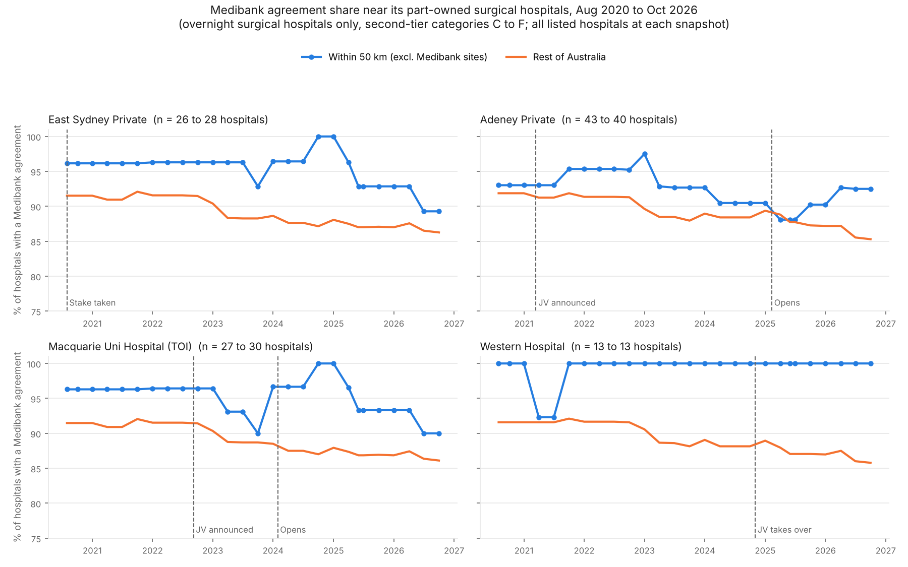

# Finding 2: Same test, overnight surgical hospitals only (categories C to F)

Date: 27 Nov 2026
Question (David): if we restrict the comparison to overnight surgical hospitals, second-tier categories C, D, E and F, and drop day hospitals (G), mental health (A) and rehab (B), is there any variance?
Code: `analysis/radius.py ... CDEF`, `analysis/detail_cdef.py`, `analysis/charts.py`
Outputs: `outputs/radius_results_CDEF.csv`, `placebo_CDEF.csv`, `events_within_50km_CDEF.csv`, `national_trend_CDEF.csv`, `regional_trend_50km_CDEF.png`

## Short answer

**Still no pattern, and in this market it is even clearer.** Medibank contracts with 90 to 100% of overnight surgical hospitals around every one of its sites, consistently above the national rate (86.7% in Oct 2026). Among hospitals listed both before and after each event, the 50 km share is unchanged or up at every site. Medibank has lost only **nine** overnight surgical agreements nationally in six years, and the three near its sites are either explained or look like data artefacts.

What moves the local lines is **new surgical hospitals opening without a Medibank agreement**, plus one public takeover. Those new hospitals are the lead worth following.

## Stable cohort, 50 km

| Site | Event | Hospitals | Before | Now | Change | Lost / gained | Rest of Australia | % of placebo areas as bad or worse |
|---|---|---|---|---|---|---|---|---|
| East Sydney Private | Stake Aug 2020 | 24 | 95.8% | 95.8% | 0.0 | 1 / 1 | -0.6 | 66% |
| Adeney | JV announced Mar 2021 | 38 | 94.7% | 97.4% | +2.6 | 1 / 2 | -1.3 | 74% |
| Adeney | Opens Feb 2025 | 40 | 92.5% | 92.5% | 0.0 | 1 / 1 | -0.6 | 100% |
| TOI (Macquarie) | JV announced Sep 2022 | 26 | 96.2% | 96.2% | 0.0 | 1 / 1 | -0.6 | 63% |
| TOI (Macquarie) | Opens Jan 2024 | 28 | 96.4% | 96.4% | 0.0 | 1 / 1 | +0.6 | 83% |
| Western Hospital | JV Nov 2024 | 12 | 100% | 100% | 0.0 | 0 / 0 | -0.5 | 100% |

The only negative readings are at 10 to 25 km and each is a single hospital: Cabrini Malvern near Adeney (-5.9 pts at 10 km) and Northern Beaches near TOI (-5.3 pts at 25 km from Jan 2024). Sample sizes are small (17 to 40 hospitals), so one hospital moves a radius by 2.5 to 6 points.

## Every overnight surgical agreement Medibank lost, Aug 2020 to Oct 2026

| Hospital | State | Lost | Near a Medibank site? | Explanation |
|---|---|---|---|---|
| Calvary Adelaide Hospital | SA | Apr 2021 (regained Oct 2021) | Yes (10 km from Western) | Zero-length-row artefact pattern; also predates the Western JV by 3 years |
| Hobart Private Hospital | TAS | Jan 2024 | No | Zero-length-row artefact pattern |
| Canossa Private Hospital | QLD | Apr 2023 | No | Not checked |
| Ardrossan Community Hospital | SA | Oct 2024 | No | Country hospital; left list |
| Victor Harbor Private Hospital | SA | Oct 2024 | No | Not checked |
| Euroa Health | VIC | Jan 2025 | No | Country hospital |
| Cabrini Malvern | VIC | Apr 2025 | Yes (6 km from Adeney) | Zero-length-row artefact pattern; no public record of a dispute. **Verify with Cabrini** |
| Northern Beaches Hospital | NSW | Jul 2026 | Yes (11 km from TOI) | Became a public hospital 29 Apr 2026 |
| Anam Cara House Geelong | VIC | Oct 2026 | No | Palliative care hospice |

3 of 9 losses (33%) are within 50 km of a Medibank surgical site, against 40.7% of overnight surgical hospitals. Fewer than proportional.

## What drives the local cross-section: new hospitals without agreements

| Hospital | Category | Near | Listed from | Medibank agreement now? |
|---|---|---|---|---|
| Monash Heart Private (Jessie McPherson) | C | 14 km from Adeney | Apr 2023 | No |
| Northern Private Hospital | F | 18 km from Adeney | Apr 2024 | No |
| Sunshine Private Hospital | D | 21 km from Adeney | Apr 2023 | Never; left list Jul 2025 |
| Wyvern Private Hospital | D | 14 km from TOI, 21 km from ESPH | Apr 2025 | No |
| Southern Sydney Private Hospital | C | 21 km from ESPH | Jun 2025 | No |
| The George Centre | D | 44 km from ESPH | Oct 2023 | Yes, from Oct 2024 |
| Camden Surgical Hospital | C | 48 km from TOI | Apr 2023 | Yes, from Jan 2024 |
| Somerset Private Hospital | C | 48 km from ESPH | Jan 2022 | Yes, at entry |
| Eastwood Private Hospital | D | 11 km from Western | Oct 2025 | Yes, at entry |

Across all new overnight surgical hospitals, those near Medibank sites are **better** contracted than elsewhere: 22% had an agreement at entry and 50% have one now, against 14% and 36% elsewhere (9 and 14 hospitals respectively, so small numbers).

## Reading

1. On contract status alone, Medibank is not cutting off overnight surgical competitors near its hospitals. Brett would lose this argument on the public data.
2. The five new surgical hospitals still without a Medibank agreement (Monash Heart Private, Northern Private, Wyvern Private, Southern Sydney Private, and Sunshine Private before it left the list) are the concrete leads. The question for each: **did they ask Medibank for an agreement and get refused or stalled, and on what terms?** That is evidence only the hospitals hold, and some may be APHA members.
3. Category tells us bed size and type, not what a hospital competes on. A better cut later is by service overlap with each Medibank site (orthopaedics, general surgery, endoscopy), which needs specialty data.

## Caveats carried from Finding 1

- Fund identity of the file still to be confirmed.
- Zero-length-row artefacts at Cabrini Malvern, Calvary Adelaide and Hobart Private still to be explained at source.
- 77 rows have no second-tier category and are excluded from this cut.
