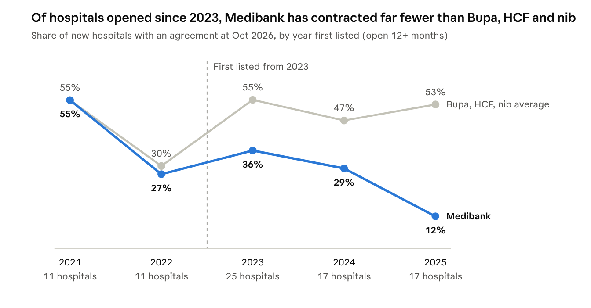

# Medibank contracting analysis: briefing for APHA

Nov 27, 2026 · @David

## Bottom line

The contracting data does not show Medibank using its hospital agreements to steer members towards hospitals it part-owns. It does show that Medibank has stopped keeping pace with Bupa, HCF and nib in contracting new private hospitals, for hospitals that opened from around 2023.

That second point is robust and can be said. The first is a finding of no evidence, not proof of innocence: conduct such as advising members to cancel booked surgery would not show up in agreement data at all.

## What we tested

We used hospital agreement status for six funds in every quarter from 1 August 2020 to 1 October 2026: 27 snapshots, 649 hospitals at the latest date. The funds are Medibank, Bupa, HCF, nib, HBF and Australian Unity (one AHSA fund). Each record is a hospital, keyed on its Commonwealth provider number, with a yes or no agreement flag per fund.

| Question                                                        | Method                                                                                                                                                                                                 |
|-----------------------------------------------------------------|--------------------------------------------------------------------------------------------------------------------------------------------------------------------------------------------------------|
| Does Medibank terminate agreements near hospitals it part-owns? | Agreement changes within 10 to 150 km of each Medibank-interest hospital, before and after Medibank took its stake, against the rest of Australia and against every other hospital as a placebo centre |
| Is Medibank slower to contract new hospitals near its own?      | Hospitals first listed after August 2020, compared fund by fund, near Medibank sites against elsewhere                                                                                                 |
| Is Medibank growing its network as fast as other funds?         | Agreement counts in August 2020 and October 2026; new hospitals compared on the same hospitals, fund against fund                                                                                      |
| When did any change start?                                      | New hospitals grouped by year first listed                                                                                                                                                             |

Medibank has ownership interests in seven declared hospitals: East Sydney Private, Adeney Private, The Orthopaedic Institute at Macquarie University Hospital, Western Hospital (Henley Beach), and the iMH hospitals at Deakin, Chatswood (Hirondelle) and Nundah. All seven are left out of every comparison of how funds contract other hospitals.

Checks: Medibank's rows match a separate Medibank-only export on 17,032 of 17,032 records; no fund's rows duplicate another's; 100 records whose end date precedes their start date were removed. Every headline figure was recomputed by a second, independent script from the raw file. Code, data and an audit workbook in which every summary figure is a formula over hospital-level rows are held by Aller Consulting.

**Source to confirm before use:** the export's origin (fund-reported agreement hospital lists) and its fund identities should be checked against each fund's published agreement hospital list.

## Finding 1: no sign of steering through contracting

Around each hospital Medibank part-owns, Medibank's agreements with competing hospitals moved in line with the rest of Australia after it took its stake.

| Test                                                                                   | Result                                                                                                                                |
|----------------------------------------------------------------------------------------|---------------------------------------------------------------------------------------------------------------------------------------|
| Agreements ended, within 50 km of a Medibank part-owned surgical hospital vs elsewhere | 4.3 vs 4.6 per 100 hospitals, Aug 2020 to Oct 2026. HCF: 4.1 vs 4.9                                                                   |
| Share of Medibank's 32 terminations within 50 km of a Medibank surgical site           | 50%, where 51.5% of hospitals are                                                                                                     |
| Overnight surgical hospitals (second-tier C to F) near each site                       | Medibank had agreements with 89% to 100% of those within 50 km at Oct 2026, against its national rate of 86.7%                        |
| Overnight surgical agreements Medibank ended nationally                                | 9 in six years; the 3 near its sites are a public takeover (Northern Beaches, Apr 2026) and two records that look like data artefacts |
| Area round East Sydney Private, Aug 2020 to Jul 2025                                   | 81.3% to 79.7% of hospitals within 30 km (100 to 98 of 123)                                                                           |
| Placebo test: the same calculation round every other hospital                          | 15% to 93% of placebo areas did as badly or worse; none of Medibank's sites is unusual                                                |

The East Sydney figure replaces the 54.89% in APHA's withdrawn August 2025 release, which used another fund's data.

On new hospitals near Medibank's sites, Medibank contracted 1 of the 5 comparable overnight surgical hospitals that opened within 25 km after it took its stake, against 93% for Bupa, HCF and nib. But it also lags on comparable new hospitals far from its sites (Newcastle and Wollongong), and the near-site difference is not statistically significant (exact permutation p = 0.11).

## Finding 2: Medibank has not kept pace since around 2023

Since August 2020 Medibank's hospital network has not grown, while Bupa and HCF have grown theirs. Counts exclude the seven Medibank-interest hospitals.

| Fund             | Agreements Aug 2020 | Agreements Oct 2026 | Change |
|------------------|---------------------|---------------------|--------|
| Bupa             | 480                 | 535                 | +55    |
| HCF              | 459                 | 495                 | +36    |
| HBF              | 512                 | 514                 | +2     |
| Medibank         | 472                 | 468                 | -4     |
| nib              | 535                 | 531                 | -4     |
| Australian Unity | 523                 | 491                 | -32    |

The gap is in new hospitals. Of 81 hospitals first listed since August 2020 and open at least a year, Medibank has agreements with 25 (31%), Bupa 46 (57%), HCF 37 (46%) and nib 37 (46%). Compared on the same hospitals:

| Comparator | Comparator has an agreement, Medibank does not | Medibank has an agreement, comparator does not | Exact test p |
|------------|------------------------------------------------|------------------------------------------------|--------------|
| Bupa       | 22                                             | 1                                              | \<0.001      |
| HCF        | 14                                             | 2                                              | 0.004        |
| nib        | 15                                             | 3                                              | 0.008        |

*Chart data: `outputs/briefing/year_cohorts_chart_data.csv`*

Aller Consulting analysis of fund agreement status by quarter, Aug 2020 to Oct 2026 · 81 new hospitals open 12+ months

For hospitals first listed before 2023 (22 hospitals) Medibank kept pace: 41% against 42% for Bupa, HCF and nib. For those listed from 2023 (59 hospitals) it has 27% against 52%. That change is statistically significant (p = 0.009), and remains so when every possible start date is tested (p = 0.039). The 2022 group shows no gap, so the shift dates from around 2023, not 2022.

It holds for both main hospital types: Medibank has 6 of 16 new overnight surgical hospitals (38%) against 62% to 75% for the three funds, and 16 of 59 new day hospitals (27%) against 39% to 53%.

HBF and Australian Unity sit close to Medibank on new hospitals (both 35%). Outside WA, HBF contracts through the AHSA, the buying group that also represents Australian Unity, and the two funds' agreement status matches on 96% of hospital-quarters outside WA against 84% in WA. The fair comparison is therefore with the funds that contract for themselves on the east coast: Bupa, HCF and nib.

## Concerns the data does not yet substantiate

Each of these is worth pursuing, but none should be stated as fact on the agreement data alone.

| Concern                                                            | What the data shows                                                                                                                                                                                                                                                                                                                                                                                                                                            | What would substantiate it                                                                                                                      |
|--------------------------------------------------------------------|----------------------------------------------------------------------------------------------------------------------------------------------------------------------------------------------------------------------------------------------------------------------------------------------------------------------------------------------------------------------------------------------------------------------------------------------------------------|-------------------------------------------------------------------------------------------------------------------------------------------------|
| New surgical competitors near Medibank's hospitals go uncontracted | Four new overnight surgical hospitals within 25 km of a Medibank site have no Medibank agreement: Wyvern Private (Terrey Hills, 13.5 km from The Orthopaedic Institute), Northern Private (Epping, Ramsay, 17.6 km from Adeney), Monash Heart Private (Clayton, 14 km from Adeney) and Southern Sydney Private (21 km from East Sydney). Bupa and nib have agreements with all four, HCF with three. Not statistically different from Medibank's lag elsewhere | The hospitals' own account: whether they sought a Medibank agreement, what they were offered, and whether Medibank's nearby capacity was raised |
| Medibank funds its own hospitals outside standard agreements       | No Medibank agreement is recorded with its iMH hospitals at Deakin (listed Jul 2023) or Nundah (listed Apr 2025), while Bupa, HCF and nib have agreements with both. Adeney shows a Medibank agreement only from Jul 2026, though Medibank's no-gap offer ran there from its opening in March 2025                                                                                                                                                             | Medibank's explanation of how it pays its part-owned hospitals, and whether those terms are available to competing hospitals                    |
| Richer medical rebates at Medibank-interest hospitals              | Not in this data. The Australian Society of Anaesthetists said in July 2026 that Adeney runs an uplift rebate schedule, reportedly 92% of the AMA rate for most procedures and 65% for endoscopy; its letter does not name the insurer                                                                                                                                                                                                                         | The rebate schedules themselves, compared with Medibank's standard gap cover at other hospitals                                                 |
| Members advised to cancel booked surgery and move                  | Agreement data cannot show conduct                                                                                                                                                                                                                                                                                                                                                                                                                             | Member or surgeon accounts, call records, complaints to the Ombudsman                                                                           |
| Oncology day units                                                 | Medibank has agreements with 6 of 11 new oncology and infusion day units; Bupa, HCF and nib with all 11. Medibank runs its own Chemo at Home program nationally, which may be a deliberate substitute. The overall gap holds without these units (27% against 37% to 50%)                                                                                                                                                                                      | Medibank's stated policy on day oncology contracting                                                                                            |

One trend runs the other way. Of hospitals first listed in 2026, Medibank already has agreements with 9 of 25 (36%), ahead of the Bupa, HCF and nib average (21%). It is too early to tell whether this is a change of approach.

## What Medibank will challenge

Medibank will test every figure against its own records. These are the likely lines of attack and where we stand on each.

| Likely challenge                               | Our position                                                                                                                                                                                                              |
|------------------------------------------------|---------------------------------------------------------------------------------------------------------------------------------------------------------------------------------------------------------------------------|
| The data is wrong or mislabelled               | Must be closed before anything is said: confirm the source and check each fund's figures against its published agreement hospital list. Medibank's rows already match a separate Medibank export exactly                  |
| No agreement does not mean no cover            | Correct. Members can still be treated at a hospital without an agreement, at default benefit rates and usually with larger out-of-pocket costs. The claim is about contracted access, not cover                           |
| Hospitals refused our terms                    | Agreement data cannot show who walked away. Only the hospitals' negotiation history can answer this                                                                                                                       |
| Agreements are signed but not yet listed       | Funds report in batches (Bupa added 66 at once in Jul 2024, nib 46 in Jul 2025). We use status at Oct 2026, after every fund's batches, and only hospitals open at least a year                                           |
| Most new hospitals are small day hospitals     | True: 59 of the 81. Counts are per hospital, not weighted by beds. The gap also holds for overnight surgical hospitals, though on 16 hospitals                                                                            |
| We fund our own hospitals differently          | Agreed, so our seven part-owned hospitals are excluded from every comparison                                                                                                                                              |
| Day oncology is better served by Chemo at Home | Possible for 11 oncology and infusion units. The gap holds without them                                                                                                                                                   |
| Why 2023?                                      | The yearly figures show the gap opening for hospitals first listed in 2023. The change stays significant when every possible start date is tested (p = 0.039), but the exact date is not precise; say "since around 2023" |

## Recommended wording and next steps

Once the data source is confirmed, these statements can be supported line by line:

1.  Agreement data from August 2020 to October 2026 shows no evidence that Medibank has ended or withheld agreements with hospitals near those it part-owns at a different rate than elsewhere.

2.  Medibank's hospital network has not grown since 2020. Leaving out the hospitals it part-owns, it had agreements with 472 hospitals in August 2020 and 468 in October 2026. Over the same period Bupa added 55 and HCF 36.

3.  Of 81 private hospitals that opened since August 2020 and have operated for at least a year, Medibank has agreements with 25. Bupa has 46, HCF 37 and nib 37.

4.  For hospitals that opened from 2023, Medibank's rate of agreement is about half that of Bupa, HCF and nib (27% against 52%).

5.  As a result, Medibank members have contracted access to fewer of Australia's newest private hospitals than members of those funds, and may face larger out-of-pocket costs at the rest.

Avoid saying that Medibank is funnelling members through its contracting, that it has stopped contracting, or that no gap is offered only at hospitals Medibank owns. Bupa signed up to Adeney's no-gap model when it opened, and none of these claims is supported by this data.

Next steps:

- [ ] Confirm the data source and check each fund's figures against its published agreement hospital list (David)

- [ ] Ask Wyvern Private, Ramsay (Northern Private), Monash Health (Monash Heart Private) and Southern Sydney Private whether they sought a Medibank agreement, and what happened (APHA)

- [ ] Ask APHA members whose hospitals opened since 2023 the same question, to test whether Medibank declined or hospitals walked away (APHA)

- [ ] Put to Medibank how it pays its part-owned hospitals at Adeney, Deakin and Nundah, and whether the same terms are open to other hospitals (APHA)

- [ ] Re-run the analysis in six months to see whether Medibank's faster uptake of 2026 openings holds (Aller)

## Sources

- Fund agreement status by hospital and quarter, Aug 2020 to Oct 2026 (export supplied by Aller Consulting; source to be confirmed). Analysis code and audit workbook held by Aller Consulting

- Medibank Group, [Annual Report 2026](https://www.medibank.com.au/content/dam/retail/about-assets/pdfs/investor-centre/annual-reports/Medibank_Group_%20Annual_Report_2026.pdf): Medibank's hospital interests

- newsGP, [first no-gap private hospital opens in Melbourne](https://www1.racgp.org.au/newsgp/professional/first-no-gap-fee-private-hospital-opens-in-melbour), Feb 2025: Medibank and Bupa signed up to Adeney's no-gap model

- Australian Society of Anaesthetists, [letter to The Age](https://asa.org.au/wp-content/uploads/2026/07/ASA-Response-to-The-Age_Redacted.pdf), 1 Jul 2026: Adeney uplift rebate schedule

- Medibank, [Chemo at Home](https://www.medibank.com.au/health-support/health-services/chemotherapy-at-home)

- Manly Observer, [Northern Beaches Hospital moves to public ownership](https://manlyobserver.com.au/northern-beaches-hospital-from-private-experiment-to-public-hands/), 2026

- Hospital + Healthcare, [APHA apology to Medibank for data error](https://www.hospitalhealth.com.au/content/facility-admin/news/peak-body-issues-apology-to-medibank-for-data-error--226765051), 28 Aug 2025
