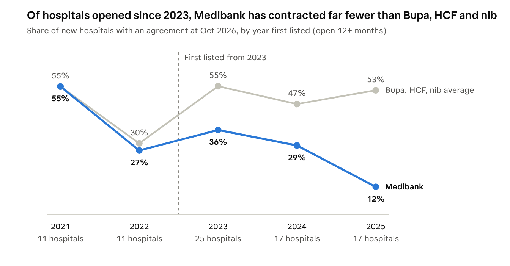

# Medibank and its part-owned hospitals: summary for APHA

Nov 27, 2026 · @David

## Summary

The data does not show Medibank using its hospital agreements to steer members to hospitals it part-owns. It does show Medibank falling well behind Bupa, HCF and nib in contracting new private hospitals since around 2023, across the country and not just near its own hospitals.

On doctors, Medibank's No Gap program covers its own hospitals and dozens of others, so it is not exclusive. Whether Medibank pays doctors better terms at its own hospitals can't be tested from public information. The reported steering of members and surgeons is conduct, not contracting, and needs evidence gathered from members, surgeons and hospitals, then a regulator with compulsory powers.

| Brett's question                                                               | What the evidence shows                                                                                                                                                |
|--------------------------------------------------------------------------------|------------------------------------------------------------------------------------------------------------------------------------------------------------------------|
| Is Medibank using hospital contracting to funnel members to its own hospitals? | No sign of it. Medibank's agreements near its hospitals changed in line with the rest of Australia.                                                                    |
| Has Medibank stopped growing its network while Bupa and HCF grew?              | Yes. Leaving out its own hospitals, Medibank had 472 agreements in Aug 2020 and 468 in Oct 2026. Bupa added 55, HCF 36.                                                |
| Does Medibank lack agreements with its own hospitals?                          | Partly. None with iMH Deakin or iMH Nundah; Adeney only from Jul 2026. It has agreements with the other four.                                                          |
| Is no gap offered only at Medibank's hospitals?                                | No. Medibank's No Gap program ran at 41 sites by mid-2025, most with no Medibank stake. Only Adeney offers it for every service, and Bupa offers the same model there. |
| Is Medibank paying doctors more at its own hospitals?                          | Not testable from public information. The contracts are confidential.                                                                                                  |
| Are members and surgeons being steered to Medibank's hospitals?                | Plausible given what APHA is hearing, but agreement data can't show conduct.                                                                                           |
| Is there a hospital or LGA split of Medibank members' admissions?              | Not public. Only Medibank, or a regulator, holds it.                                                                                                                   |

## 1. Hospital contracting: no targeting, but Medibank has fallen behind

Medibank's agreements with hospitals near the seven it part-owns moved in line with the rest of Australia after it took its stake. The gap is elsewhere: since around 2023, Medibank has contracted far fewer new hospitals than Bupa, HCF and nib, and that holds near its sites and far from them.

We used agreement status for Medibank, Bupa, HCF, nib, HBF and Australian Unity in 27 quarterly snapshots from Aug 2020 to Oct 2026, covering 649 hospitals at the latest date. Medibank's seven part-owned hospitals are left out of every comparison.

**Near Medibank's hospitals: no sign of steering**

| Test                                                                                  | Result                                                                                                                                              |
|---------------------------------------------------------------------------------------|-----------------------------------------------------------------------------------------------------------------------------------------------------|
| Agreements ended within 50 km of a Medibank part-owned surgical hospital vs elsewhere | 4.3 vs 4.6 per 100 hospitals (HCF: 4.1 vs 4.9)                                                                                                      |
| Overnight surgical hospitals within 50 km with a Medibank agreement, Oct 2026         | 89% to 100% around each site, against 86.7% nationally                                                                                              |
| Hospitals within 30 km of East Sydney Private with a Medibank agreement               | 81.3% in Aug 2020, 79.7% in Jul 2025. APHA's withdrawn 2025 release said 54.89%                                                                     |
| The same test around every other hospital (placebo)                                   | 15% to 93% of other areas did as badly or worse, so none of Medibank's sites stands out                                                             |
| New overnight surgical hospitals within 25 km of a Medibank site                      | Medibank contracted 1 of 5, against 93% for Bupa, HCF and nib. It lags as badly far from its sites, so the difference is not significant (p = 0.11) |

**Everywhere: Medibank's network has stopped growing**

| Fund             | Agreements Aug 2020 | Agreements Oct 2026 | Change |
|------------------|---------------------|---------------------|--------|
| Bupa             | 480                 | 535                 | +55    |
| HCF              | 459                 | 495                 | +36    |
| HBF              | 512                 | 514                 | +2     |
| Medibank         | 472                 | 468                 | -4     |
| nib              | 535                 | 531                 | -4     |
| Australian Unity | 523                 | 491                 | -32    |

The gap is in new hospitals. Of 81 private hospitals first listed since Aug 2020 and open at least a year, Medibank has agreements with 25. Bupa has 46, HCF 37 and nib 37. On the same hospitals, Bupa has an agreement where Medibank doesn't at 22, and the reverse at 1.

Aller Consulting analysis of fund agreement status by quarter, Aug 2020 to Oct 2026 · 81 new hospitals open 12+ months, Medibank's seven part-owned hospitals excluded

For hospitals first listed before 2023 Medibank kept pace: 41% against 42% for Bupa, HCF and nib. From 2023 it is 27% against 52%, a change that is statistically significant (p = 0.009) and holds when every possible start date is tested (p = 0.039). The gap holds for overnight surgical hospitals (6 of 16 for Medibank, 62% to 75% for the others) and day hospitals (27% against 39% to 53%).

HBF and Australian Unity also sit low (35% each). Outside WA, HBF contracts through the AHSA, which also negotiates for Australian Unity, and their agreement status matches on 96% of hospital-quarters outside WA against 84% in WA. So the fair comparison is with the funds that contract for themselves on the east coast. One trend runs the other way: of hospitals first listed in 2026, Medibank already has 9 of 25 (36%) against a 21% average for Bupa, HCF and nib. It is too early to call that a change of approach.

**Brett's specific points**

- **75.6% to 74.5%:** doesn't reproduce. The share of listed hospitals with a Medibank agreement went from 75.8% (Apr to Jun 2023) to 73.8% (Jul to Sep 2026). The fall comes from new hospitals entering without agreements, not from agreements being ended.

- **Medibank's own hospitals:** Medibank has no agreement recorded with iMH Deakin or iMH Nundah, while Bupa, HCF and nib have agreements with both. Adeney shows a Medibank agreement only from Jul 2026, though Medibank's no-gap offer ran there from its opening in 2025. It has agreements with East Sydney, Macquarie, Western and Hirondelle.

## 2. Doctor arrangements: real, but not exclusive to Medibank's hospitals

There is no public evidence of doctor agreements that Medibank offers only at hospitals it part-owns. Its No Gap program does tie a surgeon's no-gap terms to named hospitals, but most of those hospitals have no Medibank stake.

**How the program works.** A Medibank member pays no out-of-pocket costs only when both the surgeon and the hospital are in the program. If any surgeon or anaesthetist, or the hospital, is not participating, the member pays a gap ([Medibank](https://www.medibank.com.au/provider)). It covers hip and knee replacement, endoscopy, hernia, gallbladder removal, ACL reconstruction and cataracts ([Medibank](https://www.medibank.com.au/health-support/health-services/no-gap/)).

**Where it runs.**

- It began in 2019 at Vermont Private Hospital, which Medibank has no stake in, then East Sydney Private ([Medibank](https://medibank.com.au/livebetter/newsroom/post/medibank-expands-no-gap-joint-replacement-pilot-program)).

- Medibank's 2025 list names 36 hospitals. Only 3 are Medibank-linked: Adeney, East Sydney and Macquarie University Hospital. The rest include Vermont, Hurstville, Lingard, Maitland, Dubbo, Insight Albury, St Stephen's Hervey Bay and St Vincent's Werribee ([Medibank](https://www.medibank.com.au/livebetter/newsroom/post/no-gap-no-worries-10-000-medibank-customers-save-aud7-million-in-out-of)).

- It reached 41 sites by mid-2025 ([Medibank FY25](https://www.medibank.com.au/livebetter/newsroom/post/2025-full-year-results)), and St John of God Murdoch joined in Sep 2025 ([SJOG](https://www.sjog.org.au/news-and-media/media-releases/2025-1/medibank-and-st-john-of-god-health-care-announce-new-partnership)).

- Four Medibank-interest hospitals are not on the list: Western, Hirondelle, Deakin and Nundah.

**What is different at Medibank's hospitals.** Adeney is the only hospital where Medibank's no-gap offer covers every service ([Medibank](https://medibank.com.au/livebetter/newsroom/post/australias-first-no-gap-private-hospital-opens-in-melbourne)). Every surgeon who operates there has agreed to the model ([Adeney](https://adeneyprivate.com.au/adeney-insights-hub/zero-out-of-pocket-explained/)). The Australian Society of Anaesthetists reports, without confirming, that Adeney pays surgeons and anaesthetists 92% of the AMA rate for most procedures and 65% for endoscopy, without naming the insurer ([ASA](https://asa.org.au/wp-content/uploads/2026/07/ASA-Response-to-The-Age_Redacted.pdf)). Even so, the model is not Medibank-only: Bupa members get the same zero out-of-pocket offer at Adeney ([Adeney](https://adeneyprivate.com.au/faq/)), and HCF runs no-gap joint replacement at East Sydney and Macquarie ([HCF](https://www.hcf.com.au/members/no-gap-services/nogapjoints)).

**What can't be tested.** No public source shows Medibank paying doctors more at its own hospitals than at its other No Gap hospitals. The AMA says most insurers require doctors to keep contract terms confidential ([Insurance Business](https://www.insurancebusinessmag.com/au/news/life-insurance/medical-association-questions-insurer-influence-over-private-clinical-decisions-564550.aspx)), so only Medibank, the doctors or a regulator could show it.

**Aller's view.** We think it likely that Medibank pays doctors at its part-owned hospitals at a higher rate than elsewhere, to win acceptance of no-gap work and guarantee volume there. That is a suspicion, not a finding: nothing public confirms or rules it out. Two facts point the same way. The doctors under these models are often co-owners: 42 doctors hold 51% of Adeney ([Medibank](https://www.medibank.com.au/livebetter/newsroom/post/medibank-and-doctors-form-new-short-stay-no-gap-hospital-joint-venture/)) and surgeons matched Medibank's \$14.8m in The Orthopaedic Institute ([Medibank](https://www.medibank.com.au/livebetter/newsroom/post/mq-health-surgeons-and-medibank-partner-to-establish-world-class-orthopaedic)). And the number of Medibank customers using the No Gap network rose 90% in Jul to Dec 2025 against a year earlier, the first half-year comparison after Adeney opened ([Medibank HY26](https://www.medibank.com.au/livebetter/newsroom/post/2026-half-year-results)), though Medibank doesn't say how much went through its own hospitals.

## 3. Steering members and surgeons: a question for a regulator

What APHA is hearing, that Medibank advises members to cancel booked surgery and move to its hospital for no gap, is conduct. Agreement data can't see it. If it is happening and aimed at hospitals Medibank part-owns, it is a competition issue, and the body that can establish it is the ACCC, which can compel documents and information.

**Why it could matter.** Medibank is the largest insurer, with 26.5% of the market including ahm, just ahead of Bupa at 25.5% ([CHOICE, citing APRA](https://www.choice.com.au/money/insurance/health/articles/private-health-insurance-statistics-in-australia)). Section 46 of the Competition and Consumer Act 2010 prohibits a firm with a substantial degree of market power from engaging in conduct with the purpose, effect or likely effect of substantially lessening competition in a market ([ACCC](https://www.accc.gov.au/about-us/publications/guidelines-on-misuse-of-market-power)). An insurer using its benefits, no-gap offers and member advice to move surgeons and patients from competing hospitals to hospitals it part-owns could fall within that, if it weakens hospital competition in a local market.

**What the ACCC will need to see.** We are not lawyers, and APHA should get competition law advice before lodging anything. Four tests are foreseeable:

1.  **Harm to competition, not to particular hospitals.** The ACCC notes that conduct can harm an individual competitor while the test remains whether it lessens competition ([ACCC](https://www.accc.gov.au/business/competition-and-exemptions/misuse-of-market-power)). Lost bookings at one hospital are not enough on their own.

2.  **Market power.** At 26.5% nationally with Bupa close behind, substantial market power is not a given. A case is more likely to rest on a local market, such as Medibank's share of insured patients in Melbourne's inner east, or on Medibank's position as a buyer of hospital services.

3.  **Targeting, not just steering.** Insurers openly steer members to no-gap care, and a regulator may see that as good for consumers. The evidence has to show Medibank favouring hospitals it part-owns over comparable options: members moved to Adeney when their own surgeon, or a non-Medibank No Gap hospital nearby, offered similar out-of-pocket costs; or hospitals near Medibank's sites refused entry to its No Gap network.

4.  **Other provisions.** Lawyers may also look at section 47 (exclusive dealing), which covers supplying a service on condition that the customer uses a particular third party.

**A separate track for members.** Members who were told to cancel surgery can complain to the Commonwealth Ombudsman, which handles private health insurance complaints including incorrect information or advice, and looks for systemic issues ([Ombudsman](https://ombudsman.gov.au/complaints/private-health-insurance-complaints)). A pattern of complaints would also support an ACCC approach.

**The evidence to gather first**

| Evidence                                                                                                               | From                                          | What it shows                                                         |
|------------------------------------------------------------------------------------------------------------------------|-----------------------------------------------|-----------------------------------------------------------------------|
| Dated accounts of Medibank advising members to cancel or move surgery: call notes, emails, letters, the hospital named | Members, through their surgeons and hospitals | The conduct, and whether it points only to Medibank's hospitals       |
| Cancelled bookings: procedure, date, where the patient went, whether no gap was offered at the original hospital       | Surgeons                                      | Effect on competing hospitals and doctors                             |
| Medibank-member admissions by month at hospitals near Adeney, East Sydney and Macquarie, before and after each opened  | APHA member hospitals                         | A measurable shift in volume, and the local breakdown Brett asked for |
| Requests to join Medibank's No Gap network and the replies                                                             | Hospitals near Medibank's sites               | Whether competitors were shut out of the same offer                   |
| Medibank material promoting Adeney or its other hospitals to members                                                   | Members, surgeons                             | Purpose                                                               |

Because APHA's August 2025 release on Medibank had to be withdrawn, this should go to the regulator as a checked evidence pack, not as a public campaign. Each account needs a date, a named hospital and, where possible, a document.

## What APHA can and can't say

Once the data source is confirmed, each of these statements can be supported line by line:

1.  Agreement data from August 2020 to October 2026 shows no evidence that Medibank has ended or withheld agreements with hospitals near those it part-owns at a different rate than elsewhere.

2.  Medibank's hospital network has not grown since 2020. Leaving out the hospitals it part-owns, it had agreements with 472 hospitals in August 2020 and 468 in October 2026. Over the same period Bupa added 55 and HCF 36.

3.  Of 81 private hospitals that opened since August 2020 and have operated for at least a year, Medibank has agreements with 25. Bupa has 46, HCF 37 and nib 37.

4.  For hospitals that opened from 2023, Medibank's rate of agreement is about half that of Bupa, HCF and nib (27% against 52%). Its members have contracted access to fewer of the newest private hospitals and may face larger out-of-pocket costs at the rest.

5.  Adeney, which Medibank part-owns with a group of 42 specialist doctors, is the only hospital where Medibank's no-gap offer is known to cover every service and every surgeon.

6.  APHA has received reports from members and surgeons of Medibank members being advised to cancel booked surgery and move to Medibank's hospital, and believes these warrant examination by a regulator with the power to compel information.

Avoid saying:

- **Medibank funnels members through its hospital contracting.** The data doesn't show it.

- **No gap is offered only at Medibank's hospitals.** Most No Gap hospitals have no Medibank stake, and Bupa offers the same model at Adeney.

- **Medibank pays doctors more at its own hospitals.** That may be true, but nothing public shows it.

- **Medibank has stopped contracting.** It is slower, not stopped, and it leads on hospitals that opened in 2026.

- **75.6% to 74.5%.** That figure doesn't reproduce from the data.

## Next steps

- [ ] Confirm the agreement data source and check each fund's figures against its published agreement hospital list (Aller)

- [ ] Gather the evidence pack in section 3 from members, surgeons and hospitals near Adeney, East Sydney and Macquarie (APHA)

- [ ] Ask Wyvern, Northern Private, Monash Heart and Southern Sydney Private whether they sought a Medibank hospital agreement or a place in its No Gap network, and what happened (APHA)

- [ ] Get competition law advice on sections 46 and 47 before approaching the ACCC (APHA)

- [ ] Read The Age / SMH article of 1 July 2026 on Adeney and the ASA's members-only statement on private hospital ownership, which this summary does not yet draw on (Aller)

- [ ] Re-run the contracting analysis in six months to see whether Medibank's faster uptake of 2026 openings holds (Aller)

## Sources

- Fund agreement status by hospital and quarter, Aug 2020 to Oct 2026: export supplied by Aller Consulting, source to be confirmed. Method, checks and every figure in section 1: [briefing-for-apha.md](briefing-for-apha.md). Code, data and audit workbook held by Aller Consulting

- Medibank, [No Gap program](https://www.medibank.com.au/health-support/health-services/no-gap/) and [provider information](https://www.medibank.com.au/provider)

- Medibank, [no-gap joint replacement pilot expands](https://medibank.com.au/livebetter/newsroom/post/medibank-expands-no-gap-joint-replacement-pilot-program)

- Medibank, [10,000 customers through No Gap, list of 36 hospitals](https://www.medibank.com.au/livebetter/newsroom/post/no-gap-no-worries-10-000-medibank-customers-save-aud7-million-in-out-of), 2025

- Medibank, [2025 full year results](https://www.medibank.com.au/livebetter/newsroom/post/2025-full-year-results) and [2026 half year results](https://www.medibank.com.au/livebetter/newsroom/post/2026-half-year-results)

- St John of God Health Care, [Medibank partnership](https://www.sjog.org.au/news-and-media/media-releases/2025-1/medibank-and-st-john-of-god-health-care-announce-new-partnership), 23 Sep 2025

- Medibank, [Australia's first No Gap private hospital opens](https://medibank.com.au/livebetter/newsroom/post/australias-first-no-gap-private-hospital-opens-in-melbourne), 2025

- Adeney Private Hospital, [FAQ](https://adeneyprivate.com.au/faq/) and [zero out-of-pocket explained](https://adeneyprivate.com.au/adeney-insights-hub/zero-out-of-pocket-explained/)

- Medibank, [Adeney joint venture](https://www.medibank.com.au/livebetter/newsroom/post/medibank-and-doctors-form-new-short-stay-no-gap-hospital-joint-venture/) and [The Orthopaedic Institute](https://www.medibank.com.au/livebetter/newsroom/post/mq-health-surgeons-and-medibank-partner-to-establish-world-class-orthopaedic)

- Australian Society of Anaesthetists, [letter to The Age](https://asa.org.au/wp-content/uploads/2026/07/ASA-Response-to-The-Age_Redacted.pdf), 1 Jul 2026

- HCF, [No-Gap Joints program](https://www.hcf.com.au/members/no-gap-services/nogapjoints)

- Insurance Business, [AMA position statement on insurer contracting](https://www.insurancebusinessmag.com/au/news/life-insurance/medical-association-questions-insurer-influence-over-private-clinical-decisions-564550.aspx), 6 Feb 2026

- CHOICE, [private health insurance statistics](https://www.choice.com.au/money/insurance/health/articles/private-health-insurance-statistics-in-australia), citing APRA, Jun 2026

- ACCC, [guidelines on misuse of market power](https://www.accc.gov.au/about-us/publications/guidelines-on-misuse-of-market-power) and [misuse of market power](https://www.accc.gov.au/business/competition-and-exemptions/misuse-of-market-power)

- Commonwealth Ombudsman, [private health insurance complaints](https://ombudsman.gov.au/complaints/private-health-insurance-complaints)
